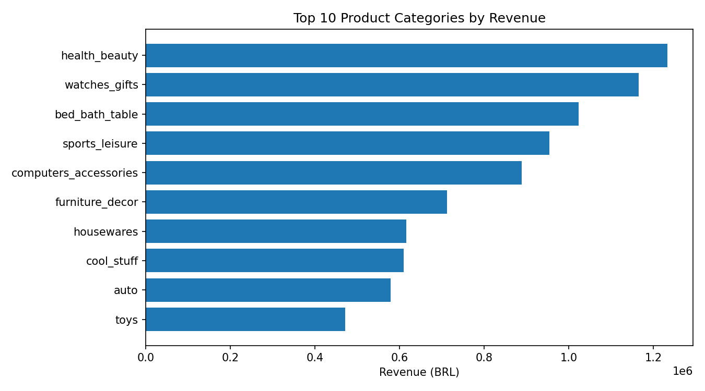
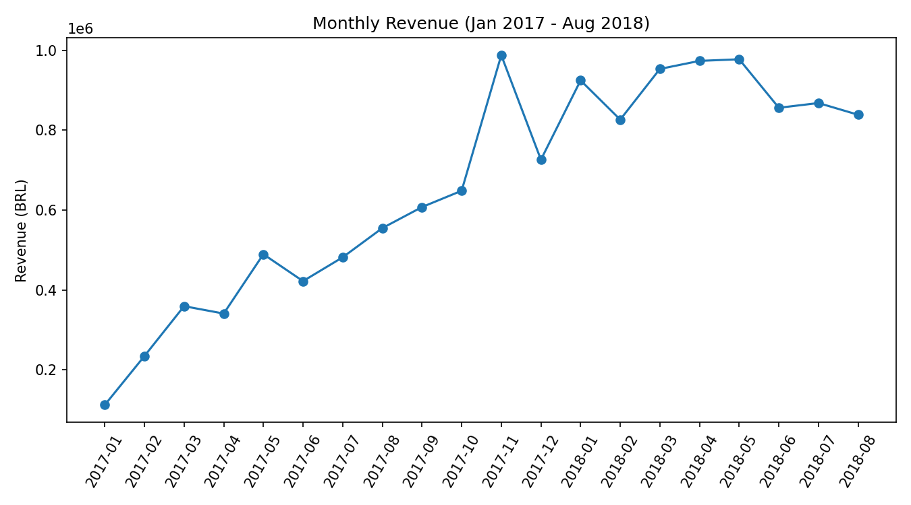
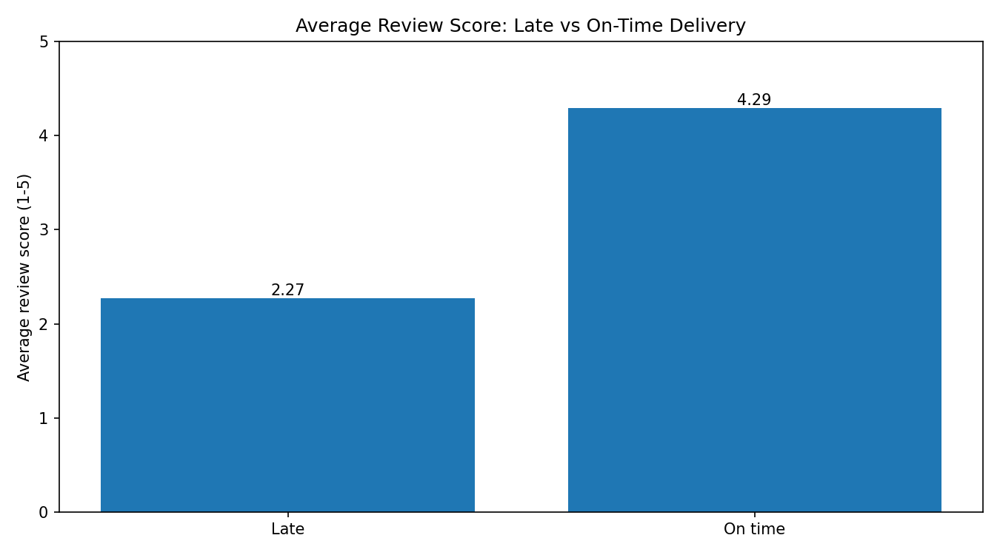
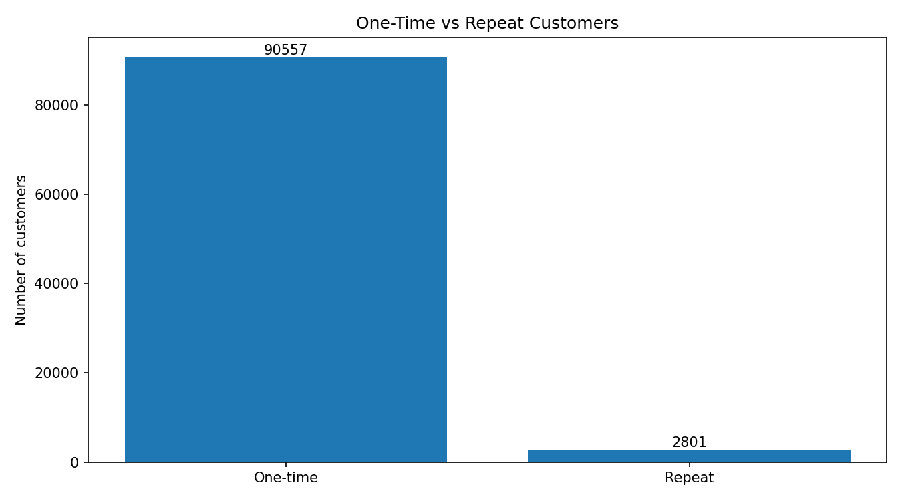
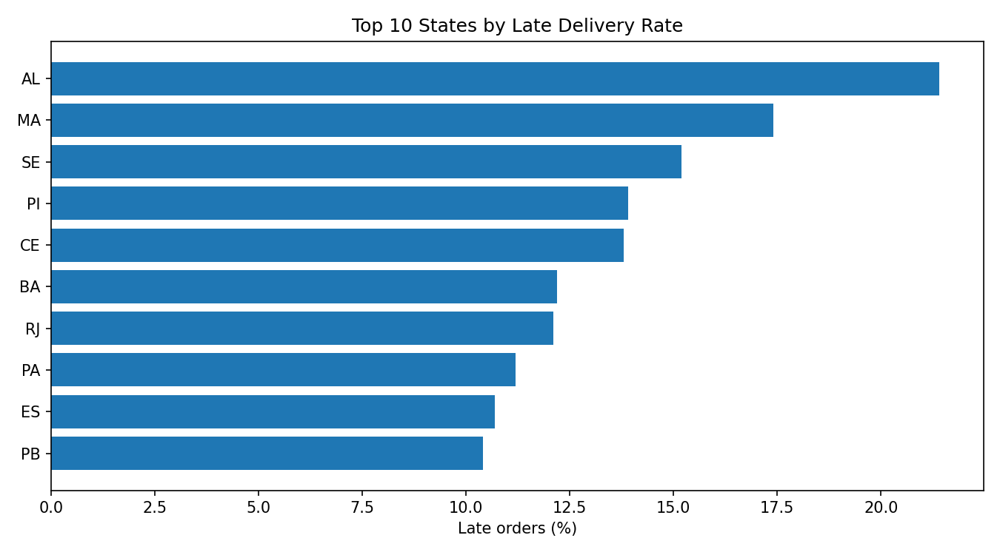
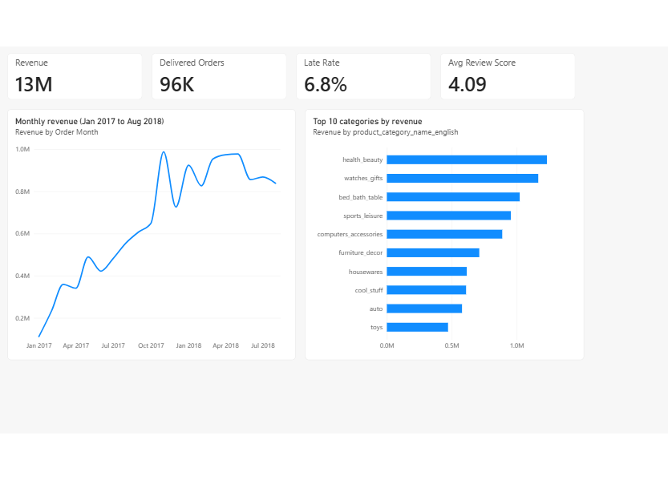
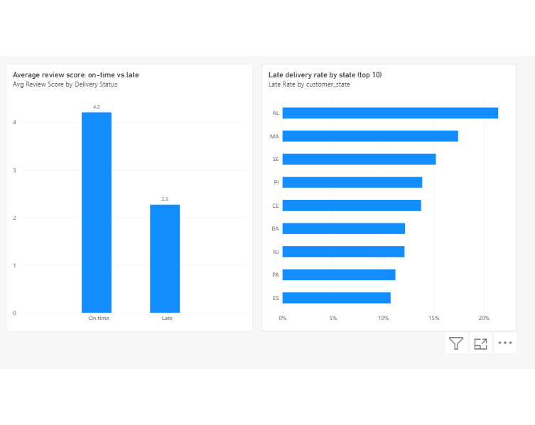
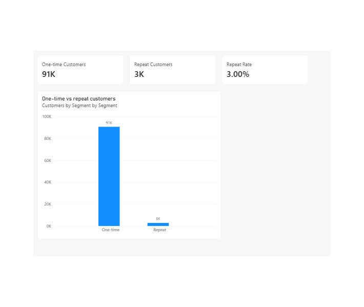

# Olist E-Commerce Sales & Delivery Analysis

An end-to-end analysis of 99,000+ orders from the Brazilian e-commerce marketplace Olist (Sep 2016 - Aug 2018). I cleaned raw data with pandas, stored it in SQLite, answered business questions with SQL, visualised the results with matplotlib, and built an interactive Power BI dashboard.

## Business questions
1. Which product categories drive the most revenue?
2. How did revenue change over time?
3. Does late delivery hurt customer reviews?
4. How many customers come back?
5. Which regions have the worst delivery performance?

## Key findings

**1. Revenue is led by a few categories.** Health & beauty (about 1.23M BRL), watches & gifts (about 1.17M BRL) and bed, bath & table (about 1.02M BRL) are the top three.

**2. Growth peaked in Nov 2017 and then flattened.** Revenue reached about 988K BRL in Nov 2017 (+52% vs the previous month), then stayed between roughly 830K and 980K a month through 2018.

**3. Late delivery sharply lowers review scores.** Only about 6.8% of orders arrive late, but they average a review of 2.27, compared with 4.29 for on-time orders.

**4. Retention is very low.** 97% of customers (90,557) bought only once; just 3% (2,801) returned.

**5. Late deliveries cluster in the Northeast and Rio de Janeiro.** Alagoas (21.4%), Maranhao (17.4%) and Sergipe (15.2%) have the highest late rates, versus 4.5% in Sao Paulo. Rio de Janeiro has 12.1% late across 12,350 orders.

## Power BI dashboard
An interactive 3-page report built on the same cleaned data, with KPI cards (Revenue, Delivered Orders, Late Rate, Avg Review Score) and charts for the five business questions. The numbers match the SQL results above.

**Overview: revenue trend and top categories**

**Delivery and reviews: late rate by state, review score late vs on-time**

**Customers: one-time vs repeat**

The report file is in `powerbi/olist_dashboard.pbix` (open with Power BI Desktop).

## Recommendations
- Prioritise logistics improvements in the Northeast states and Rio de Janeiro, where late deliveries are most concentrated.
- Proactively contact customers whose orders are running late, since late delivery is linked to much lower reviews.
- Test retention efforts (follow-up offers, review-based outreach), because repeat purchases are only 3%.

## Method
1. **Cleaning (pandas):** converted dates, handled missing values, translated product categories, removed duplicate reviews, created delivery-time and lateness metrics.
2. **Storage:** loaded the cleaned tables into a SQLite database.
3. **Analysis (SQL):** joins across multiple tables, CTEs, window functions (LAG) and HAVING filters. Queries are in the `sql/` folder.
4. **Visualisation:** matplotlib charts in the `dashboard/` folder.
5. **Dashboard (Power BI):** imported the cleaned tables, modelled the relationships, wrote DAX measures (Revenue, Delivered Orders, Late Rate, Avg Review Score, One-time and Repeat Customers) and built a 3-page interactive report in `powerbi/`.

## Assumptions and limitations
- Revenue means item price only (freight excluded) on delivered orders.
- "Late" means delivered after Olist's estimated delivery date. Remote states can show long delivery times but low late rates because their estimates are longer.
- The link between late delivery and low reviews is an association, not proof of cause.
- 2016 and the final months of the data are incomplete, so trend analysis is limited to Jan 2017 - Aug 2018.
- Unique customers are identified by `customer_unique_id`, not `customer_id`.

## Tools
Python, pandas, SQLite, SQL, matplotlib, Power BI (DAX), Jupyter Notebook

## Project structure

    olist-sales-analysis/
    |-- notebooks/    data loading, cleaning, analysis and charts
    |-- sql/          one query file per business question
    |-- dashboard/    chart images and dashboard screenshots
    |-- powerbi/      Power BI report (olist_dashboard.pbix)
    |-- README.md

## How to reproduce
1. Download the dataset from Kaggle: "Brazilian E-Commerce Public Dataset by Olist".
2. Extract the CSV files into a `data/` folder.
3. Run the notebooks in order: 01, 02, 03.

## Author
Aashika Anil N | [GitHub](https://github.com/ashcore-03)
